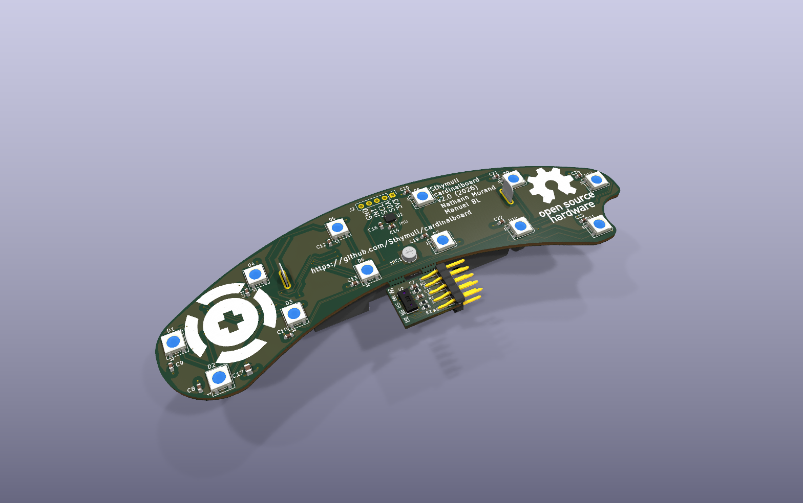

# Cardinalboard
smaller board that goes with [the motherboard](https://github.com/Sthymuli/motherboard)

## 3D view

| Top | Bottom |
|---|---|
|  |  |

## Exports

Regenerated automatically by the [export workflow](.github/workflows/export.yml) on every push to `main` that changes the design:

* [Schematic (PDF)](exports/Sthymuli-cardinalboard_schematic.pdf)
* [Layout (PDF, one page per layer)](exports/Sthymuli-cardinalboard_layout.pdf)
* 3D models (STEP), one per board as they are after breaking the mouse-bite tabs, for fit checks in the enclosure CAD:
  * [main board](exports/Sthymuli-cardinalboard.step)
  * [sensor board](exports/Sthymuli-cardinalboard_sensor.step) (mounts at 90° on J2)
* [3D render, top](exports/Sthymuli-cardinalboard_3d_top.png) / [bottom](exports/Sthymuli-cardinalboard_3d_bottom.png)

To run the same export locally: `scripts/export.sh` (see the comment at the top of the script for the Flatpak KiCad variant).
